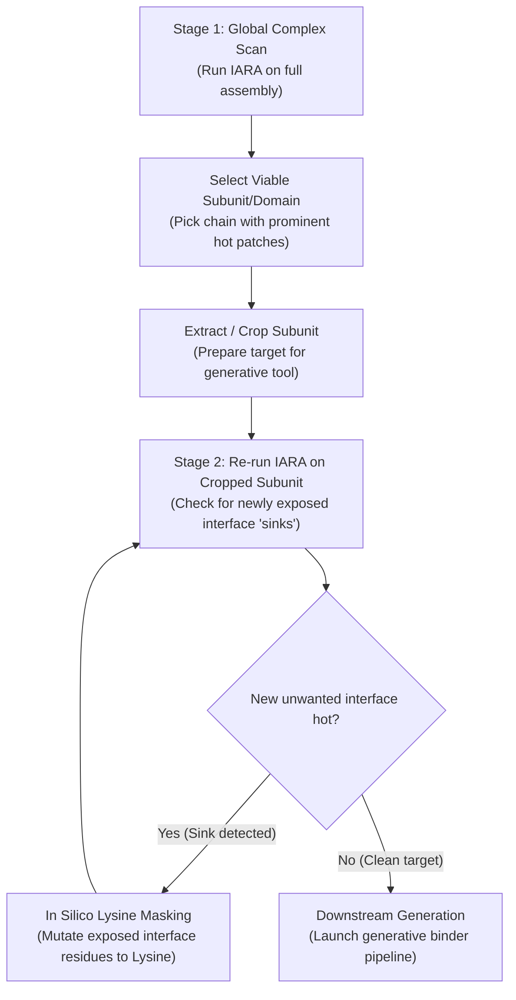

# IARA: Interface Analysis and Recognition Architecture

> *"Iara is the mother of the waters. In Brazilian folklore, she shapes the rivers and the depths. In structural biology, it is the displacement and structuring of water—the hydrophobic effect—that fundamentally drives proteins to fold and interact."*

**IARA** is an ultra-fast, lightweight Graph Neural Network (GNN) that predicts surface regions most likely to yield successful *de novo* binders with **RFdiffusion**, **BindCraft**, and **BoltzGen**.

IARA is designed to fit your workflow. You can run it three ways:
1. **As a Standalone Command-Line Script:** For high-throughput batch processing and headless integration into automated pipelines.
2. **As a GUI Plugin (PyMOL & UCSF ChimeraX):** For an interactive, single-click design experience directly inside your 3D viewport.
3. **As a Google Colab Notebook:** For zero-install, cloud-based predictions in your browser.  
   [](https://colab.research.google.com/github/leodeals/IARA/blob/main/IARA_Colab.ipynb)

> 💡 **Planning a binder design campaign?** Practical recommendations on handling multi-protein complexes, subunit extraction, and avoiding artificial interface "sinks" can be found in the [Recommended Workflow & Caveats](#-recommended-workflow-upstream-triage-in-binder-design) section at the end of this document.

---

## 👩‍🔬 Getting Started: A Quick Guide on the Basics of Computational Tools for Unexperienced Users
*If you are comfortable with the command line and Conda, please skip to the [Quick Start (For Experienced Users)](#-quick-start-for-experienced-users) below!*

Welcome! Setting up computational tools for the first time can feel daunting. We want you to be able to use IARA effortlessly either from a terminal or from right inside PyMOL or ChimeraX, without needing a computer science degree. Here is how to set everything up step-by-step.

### 1. What is Conda, and why do I need it?
IARA runs on **PyTorch**, an AI engine that requires specific, matched versions of Python and mathematical libraries. **Conda** is a package manager that creates an isolated bubble (an **environment**) where IARA's libraries live without interfering with any other software on your computer.

**Do I have Conda?**  
1. Open your **Terminal** (Mac: press `Cmd + Space` and type "Terminal"; Windows: open the Start menu and search for "Anaconda Prompt").
2. Type this command and press Enter:
```bash
conda --version
```
If it prints out a version number (like `conda 24.1.0`), you are good to go! **Skip to Step 2.**

If it says "command not found", don't worry! You just need to install Miniconda:
- **Mac/Linux/Windows Users:** Go to the [Miniconda Installation Page](https://docs.anaconda.com/free/miniconda/) and download the installer for your computer. Run the installer just like any normal application.
- *Note for Windows:* Always use the "Anaconda Prompt" app from your Start menu instead of the standard "cmd.exe" when we mention the terminal.

### 2. Creating Your IARA Environment
Now that you have Conda installed, let's create that safe "bubble" for IARA to live in. Open your Terminal (or Anaconda Prompt) and type this line carefully, exactly as written, then press Enter:
```bash
conda create -n iara_env python=3.10 -y
```

Now, tell your computer to step *inside* that new bubble:
```bash
conda activate iara_env
```

Finally, let's install the actual math and biology engines. Copy this line, paste it in the terminal, and press Enter (this will take a minute or two):
```bash
pip install torch torch-geometric prody pandas scipy
```
**Congratulations!** The hard computational part is over. You never have to type those setup commands again.

### 3. Downloading IARA 📥
1. Go to our official repository: [https://github.com/leodeals/IARA](https://github.com/leodeals/IARA)
2. Follow the standard process to download the repository folder (usually clicking the green "Code" button -> "Download ZIP"). Unzip this file in a folder where the script will be stored.  
   **(If you are the type of person with the "barbaric habit" ⚔️🛡️ of keeping absolutely everything on your desktop or the downloads folder, I won't hold this against you).**
3. Keep the AI brain (`IARA.pth`) securely *inside* that unzipped folder, right next to the file called `predict.py`. Without the brain, the code won't know what to do!

### 4. Running IARA from the Command Line 🧑‍💻
You can run IARA directly from your Terminal! This is great if you want to process many structural files at once, or if you're the kind of person who enjoys looking intensely at black screens with scrolling text to impress your lab mates.

1. Make sure your terminal is open and your bubble is active (you should see `(iara_env)` on the left side of the prompt). If not, type `conda activate iara_env`.
2. Tell your terminal to travel into the IARA folder you just downloaded. For example, if you unzipped it on your Desktop, type `cd Desktop/IARA` and press Enter.
3. You can process a **single PDB file** or an **entire folder of PDBs at once**!

Here are the commands and flags available:

| Flag | Status | What it does | Example |
|---|---|---|---|
| `--input`, `-i` | **Obligatory 🚨** | Points to your target PDB/CIF file, OR a whole folder containing multiple structures (`.pdb`, `.cif`, `.pdb.gz`, `.ent`). | `--input target.pdb`<br>`--input /my_pdbs/` |
| `--outdir`, `-o` | *Optional* 📁 | Saves the scored files into a specific folder. By default, it saves them right next to the input files! | `--outdir predictions/` |
| `--model`, `-m` | *Optional* 🤷‍♂️ | Points to the AI brain. You only need this if you moved `IARA.pth` away from `predict.py`. | `--model /custom/path/IARA.pth` |
| `-e` or `--extensive` | *Optional* 🧬 | Generates additional `_patches.json` and `.txt` files grouping hot residues into spatial patches. | `-e` |
| `-t` or `--threshold` | *Optional* 🎚️ | Minimum IARA score for a residue to be considered 'hot' in the patch grouping (default: `60.0`). | `-t 50` |
| `-d` or `--distance` | *Optional* 📏 | Maximum CA–CA distance (Å) to connect residues into the same patch (default: `5.0`). | `-d 8.0` |
| `-s` or `--min-size` | *Optional* 🧩 | Minimum number of connected hot residues required to form a valid patch (default: `3`). | `-s 5` |

**Example 1: Scoring a Single Protein**
```bash
python predict.py --input target.pdb

# Score a full folder and save to a dedicated directory
python predict.py --input /path/to/my_pdbs/ --outdir predictions/

# Generate extensive patch clustering (JSON + TXT)
python predict.py --input target.pdb -e
```

#### Available Command-Line Arguments

| Flag | Status | Description | Example |
|---|---|---|---|
| `--input`, `-i` | **Required** 🚨 | Target PDB/CIF file, or a folder containing multiple structures (`.pdb`, `.cif`, `.pdb.gz`, `.ent`). | `--input target.pdb`<br>`--input /my_pdbs/` |
| `--outdir`, `-o` | *Optional* 📁 | Destination directory for output files (default: same folder as input). | `--outdir predictions/` |
| `--model`, `-m` | *Optional* 🧠 | Custom path to weights file (default: `IARA.pth` next to `predict.py`). | `--model /custom/path/IARA.pth` |
| `-e`, `--extensive` | *Optional* 🧬 | Spatial clustering of hot residues into discrete patches (`_patches.json` and `_patches.txt`). | `-e` |
| `-t`, `--threshold` | *Optional* 🎚️ | Minimum IARA score (0–100) to classify a residue as 'hot' for patch extraction (default: `60.0`). | `-t 70` |
| `-d`, `--distance` | *Optional* 📏 | Maximum CA–CA distance in Å to connect residues into the same patch (default: `5.0`). | `-d 8.0` |
| `-s`, `--min-size` | *Optional* 🧩 | Minimum number of contiguous residues required to form a valid patch (default: `3`). | `-s 5` |

### 5. Installing the PyMOL or ChimeraX Plugins 🎨
If you prefer visual tools instead of the command line, we can connect IARA seamlessly to the 3D software you already know and love!

**For PyMOL:**
1. Open PyMOL normally.
2. In PyMOL's command line box (at the top or bottom of the screen), type `run ` and then drag-and-drop the `iara_plugin_pymol.py` file from your unzipped folder into the PyMOL window to auto-fill the path, like this:  
   `run /Users/yourname/Desktop/IARA/PyMOL/iara_plugin_pymol.py` and press Enter.
3. Tell the plugin where the AI brain is located by typing `iara_configure ` and dragging your main unzipped `IARA` folder into PyMOL:  
   `iara_configure /Users/yourname/Desktop/IARA` and press Enter.

**For UCSF ChimeraX:**
1. Open ChimeraX.
2. In the ChimeraX command line prompt at the bottom, type `open ` and drag-and-drop the `iara_plugin_chimerax.py` file:  
   `open /Users/yourname/Desktop/IARA/ChimeraX/iara_plugin_chimerax.py`
3. Tell the plugin where the AI brain is located by typing `iara_configure ` and dragging your main unzipped `IARA` folder into ChimeraX:  
   `iara_configure /Users/yourname/Desktop/IARA`

*(We permanently save this configuration setting on your computer, so when you restart your computer, you only ever need to do step #2!)*

### 6. Running Your First Prediction in 3D! 🧊
Load any protein structure you want into your viewport (for example, in PyMOL you can type `fetch 1cse`).  
To let the AI scan the surface and find the optimal binding hotspots, just type:
* **PyMOL:** `iara_predict 1cse`
* **ChimeraX:** `iara_predict #1`

Your screen will freeze for a few seconds while the GNN thinks, and then your protein will seamlessly update with a 3D heatmap! The regions colored **deep red** (probability > 50%) are the high-confidence binding hotspots perfect for *de novo* design. 

#### Wait, I didn't install the Plugin! How do I visualize it manually? 🧐
If you ran the command-line script from Step 4 and got back a `_IARA.pdb` file, here is how you manually reveal the heatmap:
* **In PyMOL:** Open the `_IARA.pdb` file, click the command line, type `spectrum b, blue_white_red, minimum=0, maximum=100` and press Enter. (Boom. Magic. 🪄)
* **In ChimeraX:** Open the `_IARA.pdb` file, go to your top menu bar, click **Tools -> Depiction -> Render by Attribute**, make sure the attribute is set to `b-factor`, select your color palette, and apply!

---

## 💻 Quick Start (For Experienced Users)

### CLI Installation & Usage

```bash
git clone https://github.com/leodeals/IARA
cd IARA
conda env create -f environment.yml
conda activate iara_env
```
Ensure you have the model weights (`IARA.pth`) in the repository root next to `predict.py`.

*(Note: The environment file leaves the CUDA version unpinned so Conda can detect your hardware automatically. If installation fails, you can explicitly set your local CUDA version inside `environment.yml`)*

**Minimal Call (recommended)**
```bash
# --model and --outdir are optional:
# model defaults to IARA.pth next to predict.py
# output defaults to the same folder as the input
python predict.py --input target.pdb
```

**Single Structure — custom output folder**
```bash
python predict.py --input target.pdb --outdir predictions/
```

**Batch Directory**
```bash
python predict.py --input /path/to/pdbs/ --outdir predictions/
```

**Extensive Patch Clustering**
```bash
python predict.py --input target.pdb -e -t 60 -d 5.0 -s 3
```

### GUI Plugin Installation

Make sure your Conda environment is named `iara_env`, or see the override below.

- **PyMOL:** `run /path/to/IARA/PyMOL/iara_plugin_pymol.py`
- **ChimeraX:** `open /path/to/IARA/ChimeraX/iara_plugin_chimerax.py`

**Configuration (Run Once):**
```bash
iara_configure /path/to/IARA
```
*(Optional) If your Conda environment is named something else, pass the override:* `iara_env_name custom_env_name`

**Running Predictions:**
- **PyMOL:** `iara_predict <object_name>`
- **ChimeraX:** `iara_predict #1`

---

## 📊 Output Formats, Score Interpretation & Parameter Tuning

When run on a target structure, IARA produces files tailored for visual analysis, programmatic parsing, and spatial patch definition:

### 1. `target_IARA.pdb` (3D Heatmap)
The standard PDB structure with original B-factors replaced by the smoothed IARA designability score (**0.0 to 100.0**) on all C-alpha atoms. Non-protein and non-CA atoms are set to zero.
- **In PyMOL:** `spectrum b, blue_white_red, minimum=0, maximum=100`
- **In ChimeraX:** **Tools -> Depiction -> Render by Attribute**, select `b-factor`, and choose a palette.

### 2. `target_IARA.json` (Per-Residue Array)
A clean, machine-readable JSON structure containing raw predictions mapped by chain and residue number for programmatic evaluation:
```json
{
  "target_file": "target.pdb",
  "predictions": [
    {"residue": "A12", "resname": "TYR", "score": 84.6},
    {"residue": "A13", "resname": "LEU", "score": 91.2},
    {"residue": "A14", "resname": "GLY", "score": 14.3}
  ]
}
```

### 3. `target_IARA_patches.json` & `.txt` (Extensive Mode `-e`)
When using `-e`, connected hot residues are clustered into discrete spatial patches using a KDTree:
- **`_patches.txt`:** Human-readable text grouping each patch and listing member residue scores.
- **`_patches.json`:** Structured dictionary of patches for automated downstream parsing.

```json
{
  "patch_1": [
    {"residue": "A56", "resname": "PHE", "score": 87.4},
    {"residue": "A57", "resname": "LEU", "score": 92.1},
    {"residue": "A60", "resname": "ILE", "score": 79.5}
  ]
}
```

### Score Interpretation Guidelines

The predicted score is a continuous metric from **0 to 100** indicating local surface designability:
- **Score > 50:** In our experience, **50** serves as a reliable general threshold to determine designable surface regions.
- **Score > 70:** A strict threshold suitable for defining high-confidence anchor hotspots for generative pipelines.

### Tuning Patch Flags (`-t`, `-d`, `-s`)
- **Threshold (`-t`, default `60.0`):** Sets the minimum IARA score for a residue to be considered 'hot' during patch clustering. Adjust to 50 for broader, more inclusive patches, or up to 70 to isolate strict core hotspots.
- **Distance (`-d`, default `5.0` Å):** Maximum CA–CA distance to group residues into the same patch. Increase to 6.5–8.0 Å for broader or slightly dispersed epitopes.
- **Min Size (`-s`, default `3`):** Minimum number of connected residues required to form a valid patch. Increase to 5–6 to filter out small isolated residue clusters.

---

## 🎯 Recommended Workflow: Upstream Triage in Binder Design

Generative design tools are computationally expensive. Forcing them to target biologically interesting but structurally featureless or un-designable patches wastes days of GPU compute. 

Because IARA runs in seconds on standard CPU hardware without requiring a GPU, it should be used as an **upstream structural triage tool** to guide where to aim computational resources before launching binder generation runs.

In practice, we recommend following a **two-stage protocol**:



### Stage 1: Global Complex Scan (Whole Assembly)
For multi-protein assemblies or large proteins, feed the intact structure into IARA first. This rapidly maps the entire surface landscape, allowing you to identify which specific subunits or domains contain viable, high-confidence designable patches (scores > 50, colored red).

### Stage 2: Subunit Extraction & The "Exposed Interface Sink" Caveat
Because generative pipelines often cannot accommodate massive multi-subunit complexes due to GPU memory constraints, researchers must extract individual subunits or domains. 

> [!WARNING]
> **The "Exposed Interface" Caveat**  
> When you extract a single subunit from a complex, you artificially expose native protein-protein interfaces (PPIs) that were previously buried. 
> 
> Because these surfaces are naturally hydrophobic and structured, **re-running IARA on the isolated subunit will show these newly exposed interfaces lighting up as intense hotspots.** When fed into generative tools, these artificial hotspots act as powerful computational **"sinks"**—the generative models may generate a large proportion (or even 100%) of their binders against this truncation surface, completely ignoring your intended biological target epitope!

### Stage 3: Re-scoring & The *In Silico* Lysine Masking Trick
To prevent generative pipelines from wasting compute on artificial interfaces:
1. **Always re-run IARA on your cropped subunit/domain** to inspect what new hotspots have appeared.
2. If an unwanted exposed interface lights up hot, **mutate those interface residues *in silico* to Lysine (`K`)** in your PDB file.
   - *Why Lysine?* Generative models (and underlying sequence-design scoring) strongly disfavor anchoring binders against surfaces dominated by bulky, positively charged, and flexible lysine side-chains.
3. **Re-score the mutated structure with IARA.** Confirm that the computational "sink" has been pacified (scores drop back to cold/blue), while your true target epitope remains hot.
4. Pass the validated hotspot residues into your downstream generative pipeline.

---

## ⚠️ Important Considerations & Known Caveats

While IARA provides high-throughput structural guidance, users must take the following biological and methodological caveats into account:

1. **Post-Translational Modifications (PTMs / Glycans):**  
   Like most structural GNNs, IARA evaluates purely the amino acid coordinates. It is **blind to glycosylation, phosphorylation, and lipid anchors**. A surface patch may receive a top IARA score in an unglycosylated model but be completely occluded by glycans *in vivo*. Always cross-reference IARA hotspots with UniProt or experimental PTM data.

2. **Unstructured / Flexible Termini:**  
   Because IARA evaluates local solvent exposure and neighbor density, highly flexible, disordered N- or C-terminal tails frequently receive elevated scores. In practical protein design, floppy tails rarely serve as stable binder targets. We strongly recommend **trimming disordered termini** before running IARA or ignoring isolated tail hotspots.

3. **Transmembrane Helices:**  
   Hydrophobic transmembrane segments score high due to their intrinsic hydrophobicity. When working with membrane proteins, focus exclusively on the soluble extracellular or intracellular domains.

4. **Designability vs. *In Vitro* Experimental Success:**  
   IARA predicts **computational generative designability**—specifically, whether generative models will succeed in anchoring geometrically and biophysically favorable binders. It cannot guarantee *in vitro* expression, solubility, or nanomolar experimental affinity ($K_D$), which depend on downstream experimental parameters.
